<picture>
  <source media="(prefers-color-scheme: light)" srcset="./assets/terminal-light.svg">
  
</picture>

### `> data path`

<picture>
  <source media="(prefers-color-scheme: light)" srcset="./assets/pipeline-light.svg">
  
</picture>

<sub>From a GPS tracker on the road to an alarm, a row in Postgres, or an e-invoice — this is the path I build.</sub>

### `> stack`

```csharp
public sealed record Samil : IBackendEngineer
{
    public string[] Domains   => ["IoT", "Fleet Telematics", "Car Rental", "E-Invoicing"];
    public string[] Runtime   => ["ASP.NET", "Worker Services", "Microservices"];
    public string[] Messaging => ["Kafka", "MassTransit"];
    public string[] Data      => ["PostgreSQL", "MSSQL", "Redis", "Dapper", "EF Core"];
    public string[] SideQuest => ["Python", "FastAPI"];

    public Task ShipAsync() => Task.FromResult("reliable, idempotent, boring in the best way");
}
```

<p align="right"><sub><code>stats auto-synced every 6h by a GitHub Action</code></sub></p>
